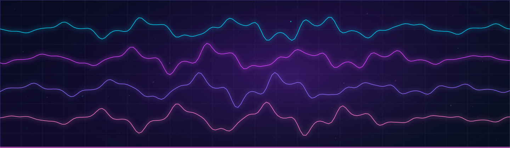

  

# Squelch

**Touch the sound.** An ambitious, touch-native creative audio platform combining live DJ performance with a long-term digital audio workstation vision.

[Product vision](https://github.com/devonalanakins/squelch/pull/5) · [Native audio prototype](https://github.com/devonalanakins/squelch/pull/2) · [Four-deck engine](https://github.com/devonalanakins/squelch/pull/1) · [Engineering progress](https://github.com/devonalanakins/squelch/pulls)

> **Source status · November 3, 2026:** The default `main` branch is documentation-only. Rust engine, device-output, sample-scheduled control and interface-design work are in **unmerged draft branches**, not a released touchscreen app or production DAW. This README describes direction and review work, not shipped functionality.

## The ambition

Squelch is designed around **four or more independently controlled digital decks**, precision touch gestures, separate master/headphone-cue pathways, and an engine suitable for offline professional performance. Dedicated turntables and DJ controllers should be optional. Physical audio input/output hardware is still required to capture and hear sound.

The longer-term direction brings recording, composition, arrangement, instruments, synthesis, mixing and mastering into the same environment. Feature scope and engineering milestones are **design targets**, not achieved capabilities.

## Engineering checkpoints

| Track | Current evidence | Status |
| --- | --- | --- |
| Four-deck offline PCM rendering | [Draft PR #1](https://github.com/devonalanakins/squelch/pull/1) | Review only |
| Native stereo output and cue-routing proof | [Draft PR #2](https://github.com/devonalanakins/squelch/pull/2) | Review only |
| Sample-timed control queue | [Draft PR #3](https://github.com/devonalanakins/squelch/pull/3) | Review only |
| Rename from Phatcake to Squelch | [Draft PR #4](https://github.com/devonalanakins/squelch/pull/4) | Review only |
| Touch-first product/architecture language | [Draft PR #5](https://github.com/devonalanakins/squelch/pull/5) | Review only |

The prototypes do **not** yet establish measured hardware latency, realistic scratching performance, playable touchscreen UI, file import, full DAW workflows or production readiness.

## Source, licensing and contributions

The code in draft branches should be reviewed with their corresponding engineering notes and tests before integration. There is no verified standalone release on `main`. **An open GitHub repository is not automatically an open-source license:** license selection is pending; redistribution and external contributions should wait for an explicit license and contribution policy.

The previous working name **Phatcake** is superseded by **Squelch**. Older names may still appear in historical commits and unmerged work; these are archival references, not current product branding.

---

Part of [Devon Alan Akins' independent software portfolio](https://github.com/devonalanakins). Repository-specific release evidence governs implementation status.
